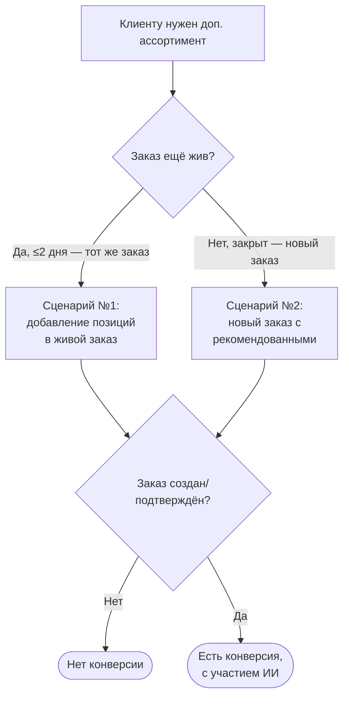

# Метрики расчёта эффекта ИИ-ассистента по заявкам клиентов

Спецификация расчёта эффекта рекомендаций (кросс-сейл ИИ-ассистента) на заявки
клиентов. Источник требований — письмо С. В. Рудакова (руководитель направления
электронных продаж, «А ГРУПП») от 15.08.2026, тема «Описание метрик по расчёту
эффекта ИИ-ассистента по Заявкам клиентов» + устные уточнения механики 1С.

Итоговая цель — **дашборд в PowerBI** с таблицей эффекта, **удельной EBITDA** и
**денежным эффектом**. Документ фиксирует определения и формулы.

> Статус: **черновик к согласованию**. Открытые вопросы — в [§9](#9-открытые-вопросы).

---

## 0. Механика 1С и принятые решения (уточнено 17.08.2026)

Три факта из разговора с заказчиком, которые задают всю модель:

1. **Заказ в 1С «живёт» ~2 дня.** Пока жив — редактируется (можно добавить
   рекомендованные позиции в **тот же** заказ). Через 2 дня 1С его **закрывает**;
   дозаказать в закрытый нельзя.
2. **После закрытия** менеджер заводит **новый** заказ и включает туда ранее
   рекомендованные позиции (плюс, как правило, позиции исходного заказа —
   фактически «переделывает» закрытый заказ + рекомендации).
3. **Статуса «отгружен/не отгружен» в 1С нет** — отгрузка определяется из
   **внешних систем отгрузки**, не из документа заказа.

Отсюда **2 дня — это срок жизни самого заказа, а не «срок жизни рекомендации»**, и
он служит **границей между сценариями**:

| Сценарий | Когда | Наблюдаемое событие |
|---|---|---|
| **№1** | заказ ещё жив (≤ 2 дн) | позиции добавлены в **тот же** `order_num` → дифф «исходное → финал» заказа |
| **№2** | заказ уже закрыт | появился **новый** `order_num` ≈ закрытый заказ **+** рекомендованные → **матч** нового с закрытым и дифф |

### 0.1 Принятые решения

- **Сценарий №2 — строгий матч + дифф.** Сопоставляем новый заказ с **конкретным**
  закрытым заказом того же клиента (по пересечению позиций + окну после закрытия),
  затем вычитаем позиции закрытого заказа — остаются **AI-добавленные** позиции.
  (Не «любой заказ с рекомендованной позицией».)
- **Конверсия = «заказ создан».** Раз статуса отгрузки в 1С нет, за конверсию
  принимаем **факт создания** нового заказа с рекомендованными позициями. Отгрузку
  как уточнение добавим позже из внешних систем отгрузки (см. §0.3, §7).
- **Сценарий №1 — снапшоты версий заказа.** Перестаём затирать заказ при ingest:
  сохраняем **версии** заказа (append-only), чтобы был дифф «исходное → финал» в
  пределах его жизни. Работает **только если 1С присылает промежуточные состояния**
  живого заказа, а не одно финальное (открытый вопрос — §9).
- **Журнала выданных рекомендаций по-прежнему НЕТ.** Рекомендатель детерминирован
  (`analyze_*` — чистые функции), `R(заказа)` **восстанавливаем реплеем**. Снапшоты
  версий — это про состояние заказа, не про лог рекомендаций.

### 0.2 Что достижимо сейчас vs позже

- **Сейчас (без новых данных от 1С, кроме версий заказа):** сценарий №2 (матч+дифф
  по `order_lines`), сценарий №1 (если приходят версии), конверсия = создание,
  срезы по нише/периоду. Реплей рекомендаций.
- **Позже:** **отгрузка** из внешних систем (уточнение конверсии и денежного
  эффекта); причинные уточнения — сигнал «менеджер увидел/принял рекомендацию»,
  строгий критерий эффекта **1B**, контроль по когортам исключений.

### 0.3 Методические оговорки (обязательно учесть)

- **Отгрузка не из 1С.** Пока конверсия = создание заказа; это **верхняя оценка** —
  часть созданных заказов не отгрузится. Точную даст интеграция с системами
  отгрузки.
- **Lookahead-bias.** Реплей `R(заказа)` должен считать профили **на момент заказа**
  (только заказы раньше него), иначе метрика «подсматривает» будущее. Существующие
  матвью — за всю историю; нужен point-in-time расчёт.
- **Матчинг — эвристика.** Сопоставление нового заказа с закрытым по пересечению
  позиций имеет порог и может ошибаться; порог и правило — §9.
- **1B практически нефальсифицируем.** «Рост без рекомендованных, приписанный доп.
  коммуникации» подпадает почти под любой рост — критерий требует согласования.

---

## 1. Бизнес-процесс (сценарии)

Оригинал схемы заказчика — вложение `image002.jpg` исходного письма (там ветвление
по «Заказ отгружён?»; отгрузку заменяем на «создан», см. §0.1).

---

## 2. Что считаем «анализируемым заказом» (атрибуция)

- Ассистент срабатывает **не во всех** заказах: есть исключения по **нишам** и
  точечные **поклиентные**. Эффект считаем **только по заказам, где ассистент
  должен был сработать** (не исключены настройками).
- Допущение заказчика: ассистент отрабатывает (явно виден менеджеру) в **100 %**
  незаисключённых заказов. Значит, знаменатель долей — множество анализируемых
  заказов, а не все заказы.

Обозначения: `N_анализ` — число анализируемых заказов; `T_анализ` — их суммарный
**исходный** тоннаж, тн.

---

## 3. Типы сценариев и типы эффекта

| Сценарий | Тип эффекта | Что засчитываем |
|---|---|---|
| №1 | **1A.** Рост числа позиций **за счёт рекомендованных** | в диффе живого заказа (исходное→финал) добавлены **рекомендованные** позиции |
| №1 | **1B.** Рост позиций/тоннажа **без рекомендованных** | заказ вырос, но не рекомендованными позициями — приписываем **доп. коммуникации** от рекомендации (критерий — §9) |
| №2 | **2.** Новый заказ с рекомендованными | после закрытия исходного заказа появился новый, сматченный с закрытым; AI-добавленные = дифф позиций |

Примечания из требований:
- по сценарию №1 эффект суммируем по **добавленным** позициям/тоннажу от исходного;
- по сценарию №2 новый заказ должен **содержать рекомендованные** позиции, но может
  содержать и нерекомендованные — эффект по требованию суммируется **по заказу в
  целом**. ⚠️ При строгом матче (§0.1) это уточняется: считаем **дифф** (новый −
  сматченный закрытый), а не весь новый заказ, — расхождение с исходной формулировкой
  вынесено в §9.

---

## 4. Жизненный цикл заказа (2 дня) и граница сценариев

- **2 рабочих дня** — срок, который заказ живёт в 1С до закрытия. До закрытия
  правки идут в тот же заказ (**сценарий №1**), после — новым заказом
  (**сценарий №2**).
- Срок должен быть **настраиваемым без доработок** (`order_lifetime_working_days`,
  по умолчанию 2) — на случай смены политики 1С.
- «Рабочие дни» → нужен **производственный календарь** РФ. Для окна матчинга
  сценария №2 базой служит **момент закрытия** исходного заказа (≈ создание + 2 дня).

---

## 5. Таблица метрик и формулы

Таблица строится по строкам «сценарий × тип эффекта» + «ИТОГО». Все доли — **от
`N_анализ`**.

| # | Колонка | Обозн. | Формула |
|---|---|---|---|
| 1 | Тип сценария | — | №1 / №2 |
| 2 | Тип эффекта | — | 1A / 1B / 2 |
| 3 | Всего анализируемых заказов, шт | `N_анализ` | общий знаменатель |
| 4 | Суммарный исходный тоннаж, тн | `T_анализ` | сумма исходного тоннажа `N_анализ` заказов |
| 5 | Заказов с приростом, шт | `n_изм` | число заказов этого типа эффекта с приростом |
| 6 | Доля заказов с приростом, % | `d_изм` | `n_изм / N_анализ × 100` |
| 7 | Суммарный прирост тоннажа от исходного, тн | `ΔT` | `Σ` прироста по диффу (см. ниже) |
| 8 | Созданных заказов с изменениями / новых, шт | `n_созд` | из `n_изм` — где эффект **реализован** (заказ создан/подтверждён) |
| 9 | Суммарный прирост по реализованным, тн | `ΔT_реал` | `Σ` прироста по созданным заказам с изменениями |
| 10 | Доля сконвертированных к созданным, % | `конв` | `n_созд / N_анализ × 100` |

> Колонки 8–10 в исходном требовании — про **отгрузку**. Пока (§0.1) «реализовано»
> = «заказ создан»; при подключении систем отгрузки колонки уточнятся до отгрузки.

Расчёт прироста (`ΔT`):
- **Сценарий №1**: `ΔT` = тоннаж финальной версии заказа − исходной (положительная
  дельта). 1A vs 1B — по признаку, были ли добавленные позиции рекомендованными.
- **Сценарий №2**: `ΔT` = дифф **(новый заказ − сматченный закрытый)** по позициям
  (см. §0.1 и оговорку §3/§9).

Строка **ИТОГО** — суммы колонок 5, 7, 8, 9 и доли `Σn_изм / N_анализ`,
`Σn_созд / N_анализ`.

### 5.1 Пример из требований (иллюстративные числа)

`N_анализ = 1000`, `T_анализ = 150 000` тн. (В требовании колонки 8–10 — про отгрузку.)

| Сценарий | Тип эффекта | n_изм | d_изм | ΔT, тн | n_созд | ΔT_реал, тн | конв |
|---|---|--:|--:|--:|--:|--:|--:|
| №1 | 1A. За счёт рекомендованных | 100 | 10 % | 1 000 | 30 | 350 | 3 % |
| №1 | 1B. Без рекомендованных | 80 | 8 % | 700 | 20 | 180 | 2 % |
| №2 | 2. Новые заказы | 120 | 12 % | 1 400 | 40 | 500 | 4 % |
| **ИТОГО** | | **300** | **30 %** | **3 100** | **90** | **1 030** | **9 %** |

---

## 6. Денежный эффект и удельная EBITDA (для PowerBI)

- **Денежный эффект** = `ΔT_реал × удельная EBITDA (₽/тн)` — по реализованному
  приросту (колонка 9).
- **Удельная EBITDA** — внешний справочник (гранулярность — §9).
- Дашборд показывает таблицу §5 + денежный эффект по строкам и в ИТОГО.

---

## 7. Пробелы данных и настройки

**Персистить в сервисе:**
1. **Версии заказа (снапшоты)** — append-only состояние заказа на каждый ingest,
   для диффа «исходное→финал» (сценарий №1). Сейчас `ingest_order_lines` затирает
   заказ целиком (delete-insert по `order_num`) → историю версий теряем. **Работает
   только если 1С шлёт промежуточные версии живого заказа** (§9).
2. Журнал рекомендаций — **не нужен** (реплей, §0.1).

**Получать от 1С (расширение контракта `docs/onec_*.md`):**
3. **Событие/таймстемп создания и закрытия заказа** — сейчас `order_date` только
   дата; для 2-дневной границы и окна матчинга нужен таймстемп (и признак закрытия).
4. **Промежуточные версии** живого заказа (см. п.1) — присылаются или нет?

**Позже (отдельная интеграция):**
5. **Статус и тоннаж отгрузки** — из **внешних систем отгрузки**, не из 1С.

**Настройки (менять без доработок):**
6. **Исключения** ассистента: по нишам и поклиентно.
7. **Срок жизни заказа** в рабочих днях (по умолчанию 2).
8. **Производственный календарь** РФ.
9. **Удельная EBITDA** (справочник ₽/тн).

---

## 8. Витрина для PowerBI

- Отдавать агрегаты как **SQL materialized view** (`effect_metrics`) или эндпоинт —
  по строкам «сценарий × тип эффекта» + ИТОГО, с колонками §5 и денежным эффектом §6.
- Гранулярность — период (месяц/квартал), ниша, сценарий.
- Пересчёт — в общем пайплайне (`sync/worker.py` / `/api/ingest/commit`).
- Черновик SQL сценария №2 — `backend/db/effect_metrics.sql` (⚠️ реализует **свободный**
  матч; строгий матч+дифф из §0.1 требует переработки).

---

## 9. Открытые вопросы

1. **Шлёт ли 1С промежуточные версии** живого заказа (иначе снапшоты не дадут дифф
   сценария №1)? Есть ли таймстемп создания и признак/время закрытия заказа?
2. **Правило матчинга сценария №2** — по какому порогу пересечения позиций считать
   новый заказ «переделкой» конкретного закрытого; окно после закрытия; как
   разрешать несколько кандидатов.
3. **Формула прироста сценария №2** — весь новый заказ (как в исходном требовании)
   или дифф «новый − сматченный закрытый» (как из строгого матча §0.1)?
4. **Разделение 1A/1B** — критерий отнесения к 1B (любой рост без рекомендованных?).
5. **Интеграция с системами отгрузки** — доступ, формат, ключ связи с `order_num`.
6. **Исключения ассистента** — где хранятся (в сервисе или приходят из 1С), формат.
7. **Удельная EBITDA** — гранулярность (общая / по группе / по периоду) и источник.
8. **Производственный календарь** — источник справочника праздников РФ.
9. **Единица `qty`** — тонны? (иначе весь тоннаж неверен).
