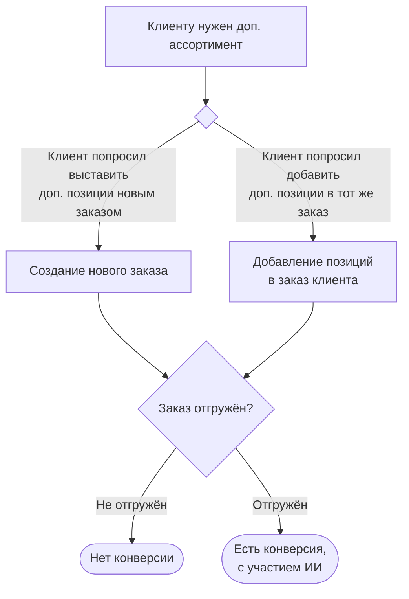

# Метрики расчёта эффекта ИИ-ассистента по заявкам клиентов

Спецификация расчёта эффекта рекомендаций (кросс-сейл ИИ-ассистента) на заявки
клиентов. Источник требований — письмо С. В. Рудакова (руководитель направления
электронных продаж, «А ГРУПП») от 15.08.2026, тема «Описание метрик по расчёту
эффекта ИИ-ассистента по Заявкам клиентов».

Итоговая цель — **дашборд в PowerBI** с таблицей эффекта, **удельной EBITDA** и
**денежным эффектом**. Этот документ фиксирует определения и формулы; часть
исходных данных сервис пока не собирает — см. [§7 «Пробелы данных»](#7-пробелы-данных-и-настройки).

> Статус: **черновик к согласованию**. Открытые вопросы — в [§9](#9-открытые-вопросы).

---

## 0. Подход к реализации (важно)

Требования заказчика описывают **live-атрибуцию**: логировать каждую рекомендацию,
снимать снапшот черновика, тянуть статус отгрузки, вести производственный
календарь. Это дорого и требует данных, которых у сервиса пока нет. Но **цель —
измерить эффект**, и бóльшую её часть можно достичь, **не реализуя всё в лоб**, за
счёт того, что уже есть в коде и данных.

**Три наблюдения по реализованному решению:**

1. **Рекомендации детерминированы.** `analyze_forgotten` / `analyze_niche`
   (`backend/app/domain/analyzer.py`) — **чистые функции** над матвью-профилями.
   Их не нужно логировать в реальном времени — для любого исторического заказа
   можно **воспроизвести (replay)**, что ассистент порекомендовал бы.
2. **История от 1С = свершившиеся заказы.** `order_lines` — это реальные заказы из
   ERP. Тогда «конверсия» во многом уже в данных: рекомендованная позиция,
   появившаяся в последующем заказе клиента, — **реализованный** кросс-сейл.
   Отдельный статус отгрузки для *первичной* оценки не обязателен.
3. **Исключения = готовая контрольная группа.** Настройки исключений (ниши/клиенты,
   §2) естественно делят заказы на когорты «ассистент включён» vs «исключён» →
   **квази-A/B** и оценка инкрементального эффекта **без снапшотов и без лога**.

### 0.1 Фаза A — бэктест на истории (сейчас, без новых данных)

Ретроспективный прогон рекомендателя по `order_lines`. Для каждого исторического
заказа `O` (клиент `c`, дата `d`) воспроизводим `R(O)` — что было бы
рекомендовано, — и проверяем по последующей истории:

- **Сценарий №2 (главный, полностью считается):** появилась ли рекомендованная
  позиция в **новом** заказе клиента `c` в окне `[d, d + L]` (§4). Доля таких
  заказов = hit-rate; тоннаж этих позиций (`qty` есть) = реализованный `ΔT`.
- **«Забытое» (сценарий №1A на межзаказном уровне):** рекомендованная позиция
  всплыла в **следующем** заказе клиента.
- Срезы по **нише** и **периоду**; сравнение когорт **включён/исключён**.

Что это даёт: **потолок реализуемого эффекта / качество рекомендаций** —
немедленно, из имеющихся данных, как первая версия витрины PowerBI и как
валидация порогов (`MIN_FREQUENCY_PCT` и пр.).

Методические оговорки (обязательно учесть):
- **Lookahead-bias.** Реплей должен считать профили **на момент `d`** (только
  заказы `< d`), иначе метрика подсматривает будущее. Существующие матвью —
  за всю историю; нужен point-in-time расчёт (оконный запрос по `order_lines` с
  фильтром по дате), а не чтение готовых матвью.
- Бэктест меряет **корреляцию/потолок** (клиент и так это купил), не чистую
  причинность. Причинность даёт контроль по исключениям (п. 3) или Фаза B.

### 0.2 Фаза B — то, что действительно требует доработок

Достраивается позже и только ради **точной причинной** метрики из §5:
внутризаказная дельта «исходное→финал» (снапшот черновика — сейчас теряется при
overwrite-on-ingest), эффект **1B**, статус/тоннаж **отгрузки** и производственный
календарь. Детали — §5, §7. До этого момента дашборд живёт на Фазе A.

---

## 1. Бизнес-процесс (сценарии)

- **Сценарий №1** — увеличение позиционности и/или тоннажа **исходного** заказа
  (клиент добавил позиции в тот же заказ).
- **Сценарий №2** — создание **нового** заказа с рекомендованными позициями.

Конверсия засчитывается **только по отгружённым** заказам («Есть конверсия, с
участием ИИ»). Оригинал схемы — вложение `image002.jpg` исходного письма.

---

## 2. Что считаем «анализируемым заказом» (атрибуция)

- Ассистент срабатывает **не во всех** заказах: есть исключения по **нишам** и
  точечные **поклиентные**. Эффект считаем **только по заказам, в которых
  ассистент должен был сработать** (не были исключены настройками).
- Допущение: ассистент отрабатывает (явно показывается менеджеру) в **100 %**
  незаисключённых заказов. Значит, знаменатель всех долей — это множество
  анализируемых заказов, а не все заказы вообще.

Обозначения:

| Символ | Смысл |
|---|---|
| `N_анализ` | число анализируемых заказов (ассистент должен был сработать) |
| `T_анализ` | суммарный **исходный** тоннаж анализируемых заказов, тн |

---

## 3. Типы сценариев и типы эффекта

| Сценарий | Тип эффекта | Что засчитываем |
|---|---|---|
| №1 | **1A.** Увеличение числа позиций **за счёт рекомендованных** | в финальном заказе появились рекомендованные позиции, которых не было в исходном черновике |
| №1 | **1B.** Увеличение числа позиций или тоннажа **без рекомендованных** позиций | заказ вырос, но не за счёт рекомендованных позиций — считаем, что **рекомендация инициировала доп. коммуникацию** с клиентом, приведшую к росту |
| №2 | **2.** Новый заказ с рекомендованными позициями | в «срок жизни рекомендации» появился **новый** заказ клиента с рекомендованной позицией |

Примечания из требований:
- эффект суммируем именно по **добавленным** позициям и/или **добавленному**
  тоннажу от исходного (сценарий №1);
- по сценарию №2 заказ должен **содержать рекомендованные** позиции, но может
  содержать и нерекомендованные — эффект суммируем **по заказу в целом** (всем
  позициям нового заказа).

---

## 4. Окно конверсии — «срок жизни рекомендации»

- Для **сценария №2**: новый заказ с рекомендованной позицией должен появиться в
  течение **срока жизни рекомендации** — по умолчанию **2 рабочих дня** с момента
  создания заказа, в котором эта позиция была изначально рекомендована.
- Срок должен быть **настраиваемым без доработок кода** (например, 3 рабочих дня
  или 5 дней) — параметр `recommendation_lifetime_working_days`.
- «Рабочие дни» → нужен **производственный календарь** РФ (учёт выходных и
  праздников). См. [§9](#9-открытые-вопросы).

---

## 5. Таблица метрик и формулы

Таблица строится по строкам «сценарий × тип эффекта» плюс строка «ИТОГО». Все
доли считаются **от `N_анализ`** (общего числа анализируемых/созданных заказов).

| # | Колонка | Обозн. | Формула |
|---|---|---|---|
| 1 | Тип сценария | — | №1 / №2 |
| 2 | Тип эффекта | — | 1A / 1B / 2 |
| 3 | Всего анализируемых заказов, шт | `N_анализ` | шапка сценариев (общий знаменатель) |
| 4 | Суммарный тоннаж анализируемых заказов, тн | `T_анализ` | сумма исходного тоннажа `N_анализ` заказов |
| 5 | Заказов с добавленными позициями/тоннажом, шт | `n_изм` | число заказов данного типа эффекта, где произошёл прирост |
| 6 | Доля заказов с увеличенным тоннажом от общего, % | `d_изм` | `n_изм / N_анализ × 100` |
| 7 | Суммарное увеличение тоннажа от исходного состояния, тн | `ΔT` | `Σ (финальный − исходный)` по добавленным позициям/тоннажу |
| 8 | Отгружённых заказов с изменениями / новых, шт | `n_отгр` | из `n_изм` — те, что **отгружены** (сценарий №2 — созданы и отгружены) |
| 9 | Суммарное увеличение отгрузки по заказам с изменениями, тн | `ΔT_отгр` | `Σ` прироста тоннажа **только по отгружённым** заказам с изменениями |
| 10 | Доля сконвертированных заказов к общему созданных, % | `конв` | `n_отгр / N_анализ × 100` |

Строка **ИТОГО** — суммы по колонкам 5, 7, 8, 9 и доли `Σn_изм / N_анализ`,
`Σn_отгр / N_анализ`.

Тонкости расчёта прироста:
- **Сценарий №1 (1A/1B)**: `ΔT` = тоннаж финального заказа − тоннаж исходного
  черновика (только положительная дельта). Разнесение в 1A vs 1B — по признаку,
  входили ли добавленные позиции в набор рекомендованных.
- **Сценарий №2**: заказ учитывается **целиком**, `ΔT` = полный тоннаж нового
  заказа (все позиции), `ΔT_отгр` — если он отгружен.

### 5.1 Пример из требований (иллюстративные числа)

`N_анализ = 1000`, `T_анализ = 150 000` тн.

| Сценарий | Тип эффекта | n_изм | d_изм | ΔT, тн | n_отгр | ΔT_отгр, тн | конв |
|---|---|--:|--:|--:|--:|--:|--:|
| №1 | 1A. За счёт рекомендованных | 100 | 10 % | 1 000 | 30 | 350 | 3 % |
| №1 | 1B. Без рекомендованных | 80 | 8 % | 700 | 20 | 180 | 2 % |
| №2 | 2. Новые заказы | 120 | 12 % | 1 400 | 40 | 500 | 4 % |
| **ИТОГО** | | **300** | **30 %** | **3 100** | **90** | **1 030** | **9 %** |

Проверка долей: `100/1000 = 10 %`, `30/1000 = 3 %`, итог `300/1000 = 30 %`,
`90/1000 = 9 %`.

---

## 6. Денежный эффект и удельная EBITDA (для PowerBI)

- **Денежный эффект** = `ΔT_отгр × удельная EBITDA (₽/тн)` — считаем по
  **отгружённому** приросту (колонка 9), т.к. только он реализован.
- **Удельная EBITDA** — вход извне (справочник; возможно, по группе товара и/или
  периоду). Источник и гранулярность — открытый вопрос ([§9](#9-открытые-вопросы)).
- Дашборд должен показывать таблицу §5 + денежный эффект по строкам и в ИТОГО.

---

## 7. Пробелы данных и настройки

> Это перечень для **Фазы B** (точная причинная метрика §5). **Фазе A (§0.1)
> ничего из этого не нужно** — она считается на имеющихся `order_lines`.

Текущий сервис (`/api/analyze` — **stateless**, ничего не персистит; контракт 1С —
только `order_lines` с `qty`, без статусов) под **полную** метрику данных не
хватает. Для Фазы B требуется добавить:

**Персистить в сервисе:**
1. **Журнал рекомендаций** — по каждому анализируемому заказу: `client_id`,
   ссылка на заказ (`order_num`), время, список рекомендованных `n3_id`/`n4_id`,
   признак «ассистент должен был сработать» (не исключён).
2. **Исходное состояние заказа** (черновик на момент `/analyze`) — чтобы считать
   дельту «финал − исходное». Сейчас `/analyze` принимает `client_id` + позиции,
   но **не связывает** их с будущим `order_num` → нужна корреляция (см. §9).

**Получать от 1С (расширение контракта `docs/onec_*.md`):**
3. **Статус отгрузки** и **отгружённый тоннаж** по заказу — сейчас в `order_lines`
   нет (только заказанный `qty`).
4. **Дата-время создания заказа** — сейчас `order_date` только дата; для окна
   «2 рабочих дня» нужен таймстемп создания.

**Настройки (менять без доработок):**
5. **Исключения** ассистента: по нишам и поклиентно.
6. **Срок жизни рекомендации** в рабочих днях (по умолчанию 2).
7. **Производственный календарь** РФ (рабочие/выходные/праздники).
8. **Удельная EBITDA** (справочник ₽/тн).

---

## 8. Витрина для PowerBI

- Отдавать агрегаты как **SQL materialized view** (напр. `effect_metrics`) или
  отдельный эндпоинт-выгрузку — по строкам «сценарий × тип эффекта» + ИТОГО, с
  колонками §5 и денежным эффектом §6.
- Гранулярность — период (месяц/квартал), ниша, сценарий — чтобы в PowerBI можно
  было фильтровать/срезать.
- Пересчёт — в общем пайплайне обновления агрегатов (`sync/worker.py` /
  `/api/ingest/commit`).

---

## 9. Открытые вопросы

1. **Связка `/analyze` ↔ заказ.** Как соотнести проанализированный черновик с
   итоговым `order_num` из 1С (передавать `order_num` в `/analyze`? возвращать
   идентификатор рекомендации, который 1С кладёт в заказ?).
2. **Семантика `order_lines`** — это уже **реализованные/отгружённые** заказы, или
   в них попадают и черновики/аннулированные? От этого зависит, нужен ли вообще
   отдельный статус отгрузки для Фазы A (§0.1).
3. **Источник статуса отгрузки и отгружённого тоннажа** (Фаза B) — та же выгрузка
   `order_lines` или отдельный поток от 1С?
4. **Что считать «исходным состоянием»** для сценария №1 — черновик на момент
   первого показа рекомендации? На момент сохранения заказа?
5. **Разделение 1A/1B** — 1B опирается на «доп. коммуникацию»: по каким признакам
   заказ относим к 1B (любой рост без рекомендованных позиций в анализируемом
   заказе)?
6. **Удельная EBITDA** — гранулярность (общая / по группе товара / по периоду) и
   источник справочника.
7. **Производственный календарь** — источник (внешний справочник праздников РФ?).
8. **Дедуп сценария №2** — если рекомендация повторялась в нескольких заказах,
   как не задвоить один новый заказ на несколько рекомендаций.
